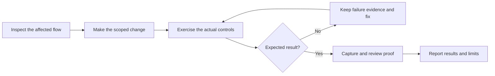
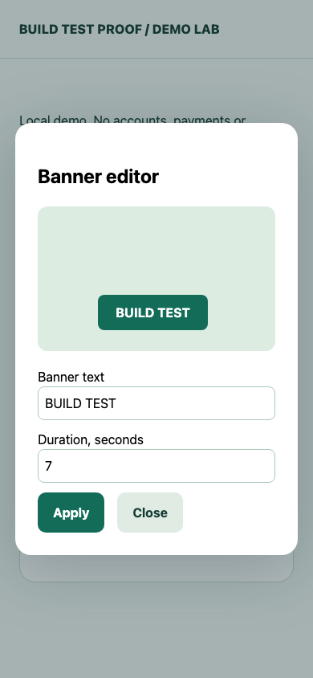
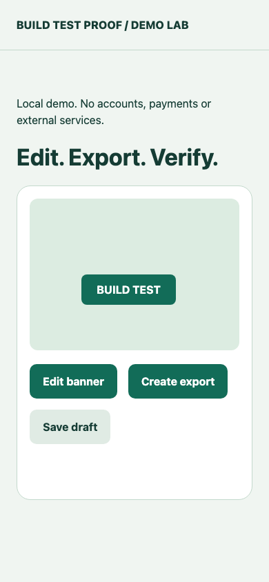
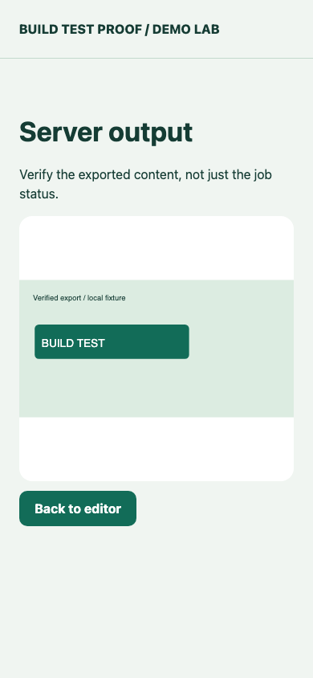
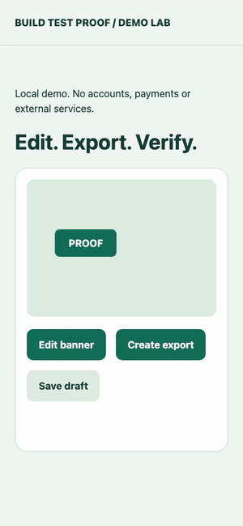

<p align="center">
  <a href="https://github.com/pogotka/build-test-proof/releases"></a>
  <a href="LICENSE"></a>
  
</p>

**Build → test → proof.** A skills-only plugin that helps coding agents verify website changes in a real browser and show what actually worked.

[Install](#install) · [Cursor / Claude / Copilot / OpenCode](HARNESSES.md) · [Automatic use](#automatic-use) · [When to use it](#when-to-use-it) · [See it in action](#see-it-in-action)

## What you get

- Fresh screenshots beside each meaningful visual change.
- Actual browser recordings for longer, multi-step flows.
- Bug reproduction, scoped fixes and reruns with the same input.
- Checks of saved records and generated output, beyond a successful request or client preview.
- Clear **passed / failed / blocked / not checked** outcomes.

The plugin supplies instructions and optional helpers. Your host or project supplies the browser. Missing dependencies are reported before installation; no silent browser downloads.

## See it in action

These are **real browser captures from a safe local demo**, not mockups or production screenshots. This run used Chromium 148 at a **390 × 844 desktop viewport**; it is not a physical phone test.

### The process



### What the evidence looks like

| 1. Exercise the editor | 2. Check the applied UI | 3. Inspect the server output |
| :---: | :---: | :---: |
|  |  |  |
| Enter **BUILD TEST**, set duration to 7, then drag the banner. | Apply and confirm the new text is visible. | Open the completed export and verify **BUILD TEST** in the actual returned SVG. |

### Watch the actual flow

[](https://github.com/pogotka/build-test-proof/releases/download/v0.2.1/flow.mp4)

**[▶ Watch / download the full browser recording — MP4, 6.8 seconds](https://github.com/pogotka/build-test-proof/releases/download/v0.2.1/flow.mp4)**

The animated preview comes from the recording. The MP4 shows the actual sequence: open editor → change text and duration → drag → apply → create export → open server result. It is not a slideshow or a trace.

### Example final report

> **Passed — editor interaction:** changed the label to BUILD TEST, waited for stable dialog geometry, and dragged it 30 px right and down inside the canvas. See the editor screenshot.
>
> **Passed — applied state:** the page displays BUILD TEST after Apply. See the applied screenshot.
>
> **Passed — server result:** opened the result link, retrieved the actual SVG with HTTP 200, and checked that BUILD TEST is present and rendered without horizontal clipping. See the output screenshot and flow recording.
>
> **Limits:** this static demo SVG does not encode duration or dragged coordinates. Those values were checked in the client and render request, not in temporal output. Draft saving, other browsers and physical devices were not checked in this recording.

## Install

**Choose your harness:** [Codex / OpenAI plugin](#codex--openai) · [Cursor, Claude Code, Copilot and OpenCode](HARNESSES.md).

### Cursor / Claude / Copilot / OpenCode

From a reviewed clone of this repository:

```sh
python3 scripts/install_skill.py --host cursor --scope user --dry-run
python3 scripts/install_skill.py --host cursor --scope user
```

Replace `cursor` with `claude`, `copilot` or `opencode`. For project scope, add `--scope project --project /absolute/path/to/project`. The installer preserves conflicting existing files and does not install browser packages or edit your rules. [Full setup and automatic-use guide](HARNESSES.md).

Claude Code also supports the included native marketplace:

```text
/plugin marketplace add pogotka/build-test-proof
/plugin install build-test-proof@build-test-proof
```

Choose standalone skill or plugin; avoid duplicates. Other hosts can use the standalone skill ZIP where they support the Agent Skills format. Their discovery paths and runtime capabilities must be checked individually.

### Codex / OpenAI

With a Codex client supporting plugin marketplaces:

```sh
codex plugin marketplace add pogotka/build-test-proof --ref main
codex plugin add build-test-proof@build-test-proof --json
codex plugin list --marketplace build-test-proof --json
```

Open a fresh chat and check that **BuildTestProof** appears in the skill catalog. If the client needs a refresh or restart, save your work first. Installation alone does not prove that an already-open chat has loaded the skill.

For a deliberate first check, select the skill in the picker or use its actual catalog name. The tested Codex name is:

```text
Use $build-test-proof:build-test-proof to verify this website change.
Show fresh evidence beside each result.
```

Already using the local installation? Keep it; do not install a duplicate just to use this repository. Choose one update source. [User guide](plugins/build-test-proof/USER_GUIDE.md) · [Release ZIP](https://github.com/pogotka/build-test-proof/releases/latest).

## Automatic use

The skill allows implicit invocation and describes the relevant work. The agent can select it without a skill mention when the task matches. This is task routing, not an always-on event hook, and selection is not guaranteed in every chat.

For Codex personal defaults, put the block from [AUTO_USE.md](plugins/build-test-proof/AUTO_USE.md) in `~/.codex/AGENTS.md`. For one project, put it in that project's `AGENTS.md`. Preserve existing instructions and check for `AGENTS.override.md` precedence.

Then an ordinary request is enough:

> Fix the mobile dialog layout and verify that submitting the form saves the record correctly.

The skill should apply because the task changes a website flow. It does not grant permission to deploy, use production accounts or install packages. [Agent/project guide](plugins/build-test-proof/AGENT_GUIDE.md).

## When to use it

| Change | Verification |
| --- | --- |
| Layout, copy, responsive UI | Browser interaction + fresh screenshot |
| Dialog, drag/resize, navigation | Actual affected actions; wait for stable geometry |
| Authentication, form save, web export, generated media | Browser → API → actual saved/generated result, plus relevant integration checks |
| Long journey across screens | Concise actual flow video |
| Internal backend refactor, DB index, infrastructure, non-web job | Appropriate technical tests; no mandatory browser captures |

Scope follows the **affected behavior**, not the filename or whether a repository happens to have a frontend. A backend bug can need browser proof; a backend-only change can be fully verified without screenshots.

## Evidence you can trust

A screenshot proves a visible state, not every server assertion. A client preview is not proof of the encoded export. A trace or screenshot montage is not a flow recording. Reports disclose these limits.

For a multi-run handoff, an optional `FINAL_INDEX.json` selects the final run, revision, environment and scenario coverage. The included validator checks references and declared consistency; it cannot prove that tests were performed. Evidence stays outside the application's source tree and is not committed by default.

## Tested behavior

The preceding 0.2.0 implementation was exercised in fresh chats: explicit catalog use and ordinary-prompt implicit use; desktop and narrow browser flows; an observed output bug followed by fix and rerun; screenshots and decoded actual videos. Optional helper tests covered 6 geometry cases and 18 evidence-index invariants. That does not establish universal automatic selection or full-site coverage.

0.2.1 clarifies routing for website-facing backend changes and adds distribution/automatic-use documentation. It retains the tested helpers. Real-project evidence is intentionally kept outside this public repository.

The 0.3.0 distribution adds portable installers, a standalone skill ZIP and Claude Code native manifests. Installer behavior and package layout are tested; actual discovery/activation in the four additional harnesses has not been runtime verified in this authoring environment. See [compatibility status](HARNESSES.md#compatibility-status).

## Package and resources

```text
.agents/plugins/marketplace.json   GitHub marketplace
plugins/build-test-proof/
  plugin.json                     Portable plugin manifest
  skills/build-test-proof/         Skill, references and optional helpers
  AUTO_USE.md                     Persistent routing rule
  USER_GUIDE.md                    Installation and everyday use
  AGENT_GUIDE.md                   Project instructions
scripts/package.py                Build plugin and standalone skill ZIPs
scripts/install_skill.py          Install into the chosen harness
.claude-plugin/marketplace.json   Claude Code marketplace
HARNESSES.md                      Cross-harness setup and limits
```

```sh
python3 scripts/package.py
```

The plugin ZIP contains the plugin only; the standalone ZIP contains the skill folder and its resources. Optional helpers need Node.js (browser probe/geometry) or Python 3.9+ (index validator); no runtime dependency installation is bundled.

## License and author

[MIT](LICENSE) · **npdev** · [npdev.ru](https://npdev.ru)

GitHub distribution is independent of OpenAI public-directory review. This repository does not imply an approved directory listing.
